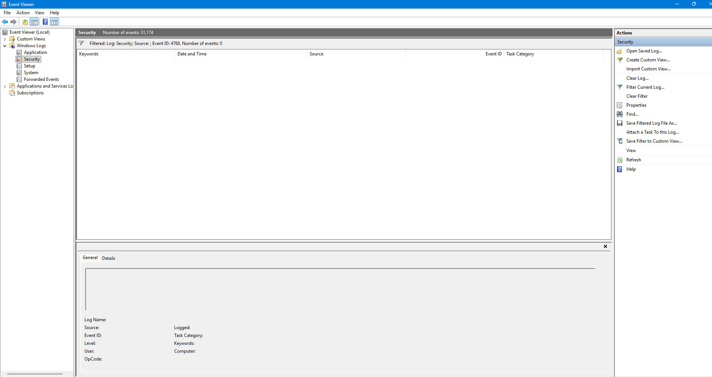

# AD Honey Account Tripwire — Active Directory Deception

**Problem:** Attackers love AD — BloodHound enumeration, Kerberoasting. EDR often misses enumeration.

**Flow:**
1. Create honey account name `svc_finance_backup` (attractive name, no real access)
2. Plant decoy file `AD_Credentials.txt` on Desktop with fake password (lab-safe)
3. Simulate detection: Windows Event ID 4768 (Kerberos TGT Request) or 4625 (Failed Logon) for that user
4. Detection: `Detect-HoneyLogon.py` parses sample JSON with TargetUserName, IpAddress, EventID and formats alert for SOAR workflow

**Placement:** Good places for this honey user: Finance OU, Service Accounts OU, Domain Admins group description — attractive to BloodHound enumeration.

**MITRE:** T1087 Account Discovery, T1558 Kerberoasting (4769), T1110 Brute Force (4625)

## Lab Status — Why 0 events is expected (not Proof)

This is a lab-safe simulation. On this standalone Windows 11 laptop (non-domain), the Security log filtered for Event ID 4768 shows 0 events — expected behavior.

**Why 0 events:**
- Event ID 4768 = Kerberos TGT Request — only generated on a Domain Controller with Kerberos auditing
- This laptop is not a domain controller, so no real 4768 for `svc_finance_backup`
- In production: Enable auditing on DC, create real AD user `New-ADUser -SamAccountName svc_finance_backup`

**What this lab shows instead:**
- `sample_honey_event.json` — sample Event ID 4768 payload for parser testing
- `Detect-HoneyLogon.py` — parses sample JSON and formats alert for SOAR workflow
- Parser output: `[ALERT] Honey account TGT request — User: svc_finance_backup | Source: 192.168.56.101 | Event: 4768`

Author: Brian Rayoni, Randburg, SA
